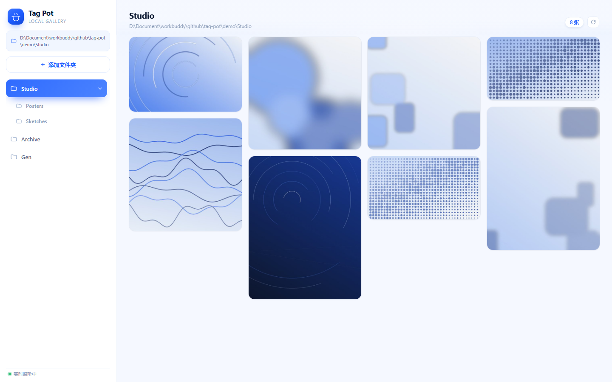
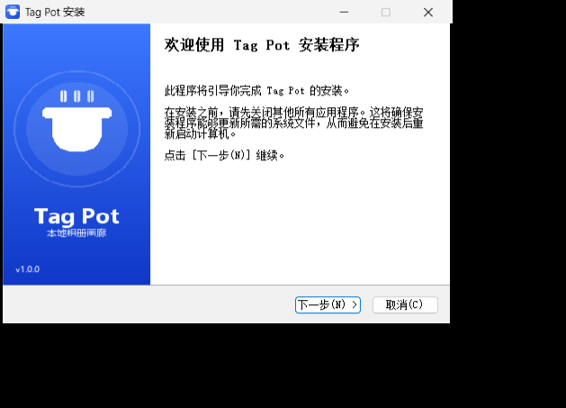
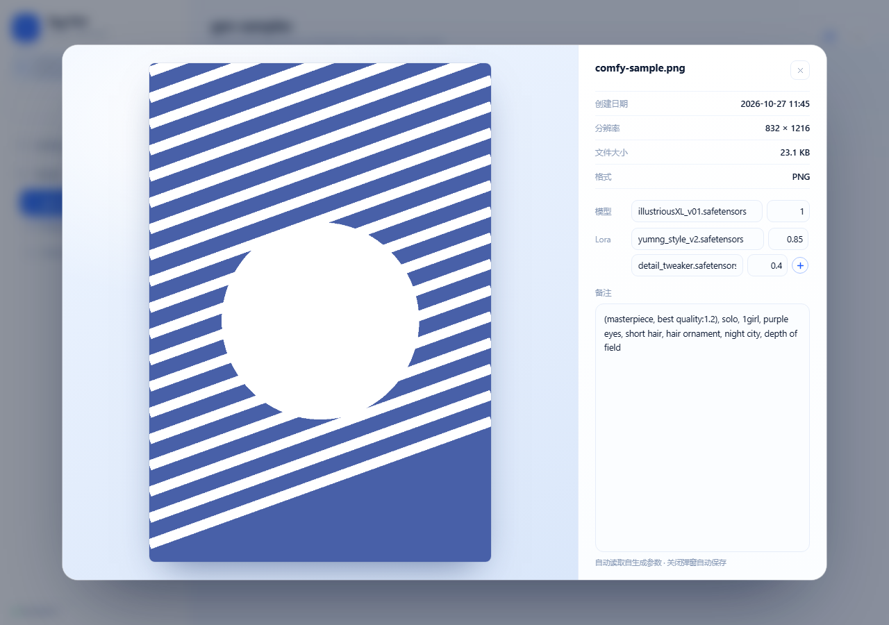

# Tag Pot

本地相册画廊，是一个 **Windows 桌面软件**：独立窗口、任务栏图标、无地址栏、不经过浏览器。
蓝白主题，左侧文件夹导航，右侧瀑布流，点击图片进入属性弹窗。全程离线，图片不出本机。



## 安装

到 [Releases](https://github.com/yumng666/TagPot/releases/latest) 下载：

| 文件 | 说明 |
| --- | --- |
| `TagPot-Setup-1.0.0.exe` | **安装版**（推荐）。一路「下一步」即可，装到 `%LOCALAPPDATA%\Programs\TagPot`，全程不需要管理员权限；自带开始菜单、桌面快捷方式和卸载项，可在「设置 → 应用」里卸载。 |
| `TagPot.exe` | **绿色版**。单文件约 33 MB，放进任意可写目录双击运行。 |




两者运行表现一致：

- 冷启动约 2.7 秒（单文件要先自解包），之后窗口秒开。
- 用户数据（配置、缩略图缓存、WebView2 数据、演示相册副本）在 `%LOCALAPPDATA%\TagPot`；
  绿色版若同目录已有 `data\`，则沿用那一份，方便放 U 盘带着走。
- 窗口尺寸按屏幕自动取（1360×880 上限，小屏自动收），最小 960×600；任务栏按独立应用归组。
- 关掉窗口即退出，后台服务随之结束。
- 若 Windows 弹 SmartScreen，是因为 exe 没有代码签名：点「更多信息 → 仍要运行」。

## 从源码构建

```
run.bat              # 直接从源码启动（走 app.py，同样不开浏览器）
build_exe.bat        # 打 dist\TagPot.exe（需 pyinstaller，依赖装到 vendor\）
build_installer.bat  # 打 dist\TagPot-Setup-<版本>.exe（需 NSIS 解压到 tools\nsis\）
```

## 交互

### 左侧栏

自上而下：软件图标与名称 → 当前文件夹路径 → 「添加」按钮 → 文件夹列表。

- **滑动选中块**：选中背景是独立图层，只动自己，文字不动。位置、宽度、高度都跟随目标项变化，
  子项缩进后选中块随之变窄。快速连续切换时由同一个元素在原地改目标值，
  过渡会从当前所在位置继续，不会跳回起点。
- **路径同步**：选中任何一项（含子项），上方路径栏立即变成该文件夹的完整路径。
- **就地展开子菜单**：点击含子文件夹的项，子菜单在父项下方展开，容器高度与其后所有栏目的位置同步下移；
  子项按 `34ms` 错峰依次浮现。手风琴模式，界面上只保留一组展开状态。
- **添加（两种方式）**：
  1. **点「添加文件夹」** → 弹出内置选择器：地址栏可直接粘贴完整路径回车直达，
     上方有面包屑和桌面/下载/图片等快捷入口，左侧列出所有盘符（含映射的网络盘），
     右侧是当前目录的子文件夹。单击选中、双击进入，确认后成为新的根栏目。
  2. **把文件夹拖到「添加文件夹」按钮上**：拖入时按钮变成蓝底并出现虚线呼吸框、
     文案变为「松手即可添加」，松手即加入。拖放的真实路径来自 WebView2 的
     `AdditionalObjects`（HTML5 拖放拿不到绝对路径），仅在桌面版可用。
  悬停根栏目右侧的 × 可移出列表（不动磁盘文件）。

### 右侧

- 瀑布流（最短列优先），列数随窗口宽度在 2–6 之间自适应，回流动画带缓动。
- **实时刷新**：每 2 秒比对一次目录，新增图片淡入、删除图片淡出，无需手动刷新。
  右上角按钮可强制立即刷新。

### 弹窗

点击任意图片打开。左侧图片，右侧自上而下：图片名称、创建日期、分辨率、文件大小、格式、备注。

- **模型 / Lora**：自动识别 ComfyUI 与 NovelAI 的元数据。
  ComfyUI 取 `CheckpointLoader` 的模型名、`LoraLoader` 的文件名与强度、以及 `KSampler` 的 `positive`
  连到的正向提示词；NovelAI 只显示「Nai + 版本」（如 `Nai 3` / `Nai 4` / `Nai 4.5`），不显示模型强度与 Lora。
  
- 模型、Lora、备注**三项都可以手改**，改过哪一项以后就显示你改的值，没改的继续跟元数据自动同步；
  Lora 最后一行右侧有个圆形加号按钮，点一下追加一行（按钮始终只有一个）。
  自定义内容存在 `data/annotations.json`，备注本身仍然写进文件属性。
- 备注就是 **Windows 文件属性里的「备注」**（右键 → 属性 → 详细信息 → 备注，即
  `System.Comment`），通过 Windows 属性系统读写，不另建一套自己的备注。
  JPEG / PNG 等格式由系统按各自规范落盘（实测 JPEG 落 `XPComment`、PNG 落 XMP），
  所以软件里显示的和资源管理器里看到的永远是同一个值。
- 修改后**关闭弹窗时自动保存**，且只改元数据、不重新编码，画质无损。
  仅当系统拒绝写入某格式时才退回 `data/comments.json`，此时界面会标注「备注只存在应用内」。
- 点蒙层空白处、点关闭按钮、按 `Esc` 都能关闭；`←` `→` 切换上一张/下一张。

## 结构

```
tag-pot/
├─ dist/TagPot.exe         # ★ 成品：单文件桌面程序
├─ build_exe.bat           # 打包单文件 exe
├─ build_installer.bat     # 生成安装包
├─ installer/tagpot.nsi    # NSIS 安装脚本（每用户安装，免管理员）
├─ run.bat                 # 源码方式启动（开发用）
├─ app.py                  # 桌面外壳：WebView2 原生窗口 + 本地服务
├─ server.py               # 后端：图片 / 缩略图 / EXIF 备注（也可单独跑，纯接口）
├─ assets/tagpot.ico       # 应用图标（多尺寸）
├─ web/
│  ├─ index.html
│  ├─ style.css
│  └─ app.js               # 滑动选中、折叠动画、瀑布流、弹窗
├─ scripts/
│  ├─ make_icon.py         # 生成图标
│  └─ make_demo.py         # 生成演示素材
├─ vendor/                 # 源码方式运行时的依赖：piexif + pywebview + pythonnet
├─ demo/                   # 演示相册（打包时会塞进 exe，首启释放到 data/demo）
├─ data/                   # 源码方式运行时的配置与缓存
└─ tests/
   ├─ test_ui_browser.mjs  # 真实浏览器端到端验证（零依赖）
   └─ shots/               # 验证截图
```

打包后的目录结构只有两样东西：

```
dist/
├─ TagPot.exe
└─ data/        ← 首次运行自动生成
```

## 接口

| 方法 | 路径 | 说明 |
| --- | --- | --- |
| GET | `/api/state` | 已添加的根目录 |
| POST | `/api/roots` | 添加根目录 `{path}` |
| POST | `/api/roots/remove` | 移除根目录 `{id}` |
| GET | `/api/fs/places` | 盘符 + 桌面/下载/图片等常用位置 |
| GET | `/api/fs/list?path=` | 文件夹选择器用的通用目录浏览 |
| GET | `/api/drop/take` | 取走 WebView2 回传的拖入路径 |
| GET | `/api/dirs?path=` | 列出子目录 |
| GET | `/api/images?path=` | 列出图片 + 子目录 |
| GET | `/api/meta?path=` | 名称/时间/分辨率/大小/备注 |
| POST | `/api/comment` | 写入备注 `{path, comment}` |
| POST | `/api/annotation` | 保存模型 / Lora 的自定义 `{path, model, loras}`，传 `null` 表示撤销 |
| GET | `/api/thumb?path=&w=` | 缩略图（磁盘缓存） |
| GET | `/api/full?path=` | 原图 |

只允许访问已登记根目录内部的文件，路径不合法一律 404。

## 验证

生成参数解析（ComfyUI / NovelAI，纯 Python，现造样本图）：

```
python tests/test_gen_meta.py
```

界面逻辑（无头 Chromium 里真操作，含截图）—— 对 exe 也适用，先启动 TagPot.exe 再跑：

```
node tests/test_ui_browser.mjs http://127.0.0.1:8765
```

覆盖：静态资源 MIME、路径同步、子菜单就地展开、选中块位置与尺寸贴合、
快速连续切换落位、瀑布流多列无重叠、实时增删刷新、弹窗字段读取、
备注自动保存回显、点蒙层关闭、添加文件夹全流程、控制台无异常。

桌面窗口本身：

```
TAGPOT_LOG=1 python app.py        # 请求写进 data/http.log，核对页面是否真的加载
TAGPOT_SELFTEST=1 python app.py   # 启动后自检并自动关闭
```

> 注：WebView2 的画面无法被 BitBlt/PrintWindow 抓取（同环境下纯色页面抓出来也是黑的），
> 所以窗口层用「窗口存在 + 资源全部 200 + 页面 JS 跑完整流程」来验证，视觉截图来自同款 Chromium 内核。

## GitHub 同类项目检索结论

开工前用 GitHub 搜索 API 检索过多组关键词（`photo gallery desktop`、`image viewer masonry`、
`local photo manager`、`electron photo gallery` 等），结论是**有同类，但没有可直接用的一体化项目**：

- **重型本地照片管理器**：`julyx10/lap`（4k★，本地 AI 搜索、文件夹优先）、
  `OliverZhaohaibin/iPhotron`（231★，Qt6，仿 macOS 照片）、`Bitpainter75/FerrumPix`（737★）。
  功能远超本需求，且都没有「选中态连续滑动 + 就地展开子菜单 + EXIF 备注就地编辑并自动保存」这套交互。
- **纯浏览型**：`wlm3201/Masonry_Image_Viewer`（413★，正好是瀑布流本地图片浏览器）、
  `dimsemenov/PhotoSwipe`（25k★，lightbox 组件）。只有「看」，没有目录树、没有备注读写。
- **剩下的都是零件**：瀑布流布局库、灯箱库，需要自己拼装。

所以这个项目是自研的，只借鉴了两点思路：灯箱的遮罩/居中策略、瀑布流的「最短列优先」放置算法。
